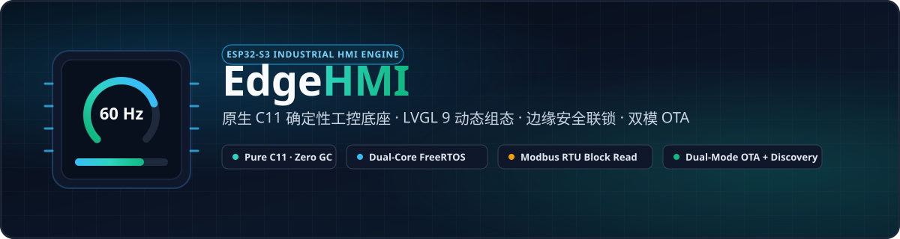
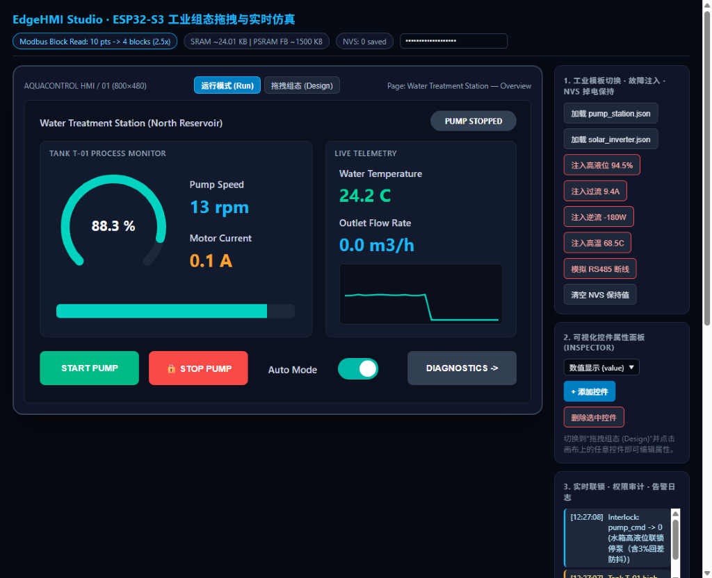
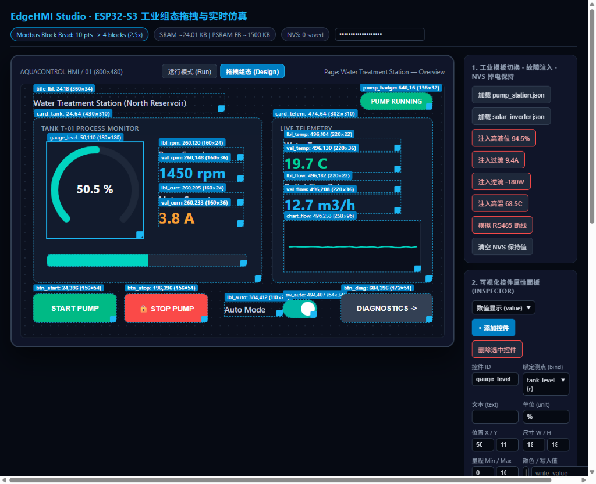
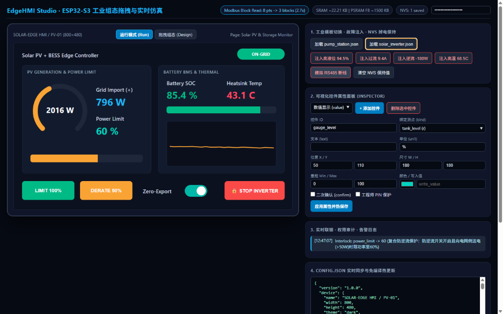
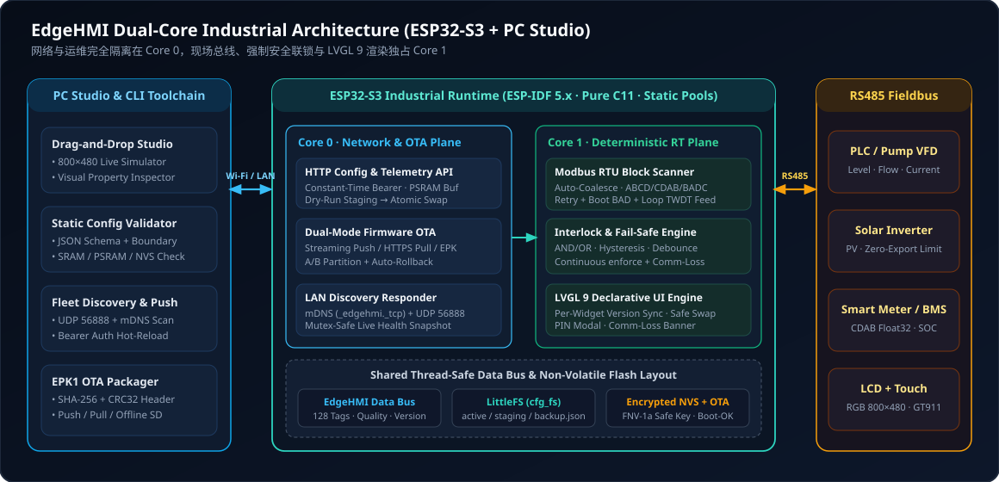

<div align="center">



<br/>

[](https://docs.espressif.com/projects/esp-idf/en/latest/esp32s3/)
[](https://lvgl.io/)
[](firmware/components/edgehmi_core)
[](firmware/components/edgehmi_core/src/modbus_rtu.c)
[](firmware/main/ota_firmware.c)
[](tests)

**专为工业现场打造的 ESP32-S3 原生 C11 组态屏与边缘控制引擎**  
*一次编写 `config.json`，在 PC Studio 拖拽仿真验证，一键免编译热推至工业触摸屏真机*

[特性亮点](#-核心特性) · [实时界面预览](#-edgehmi-studio-实时仿真与组态预览) · [双核架构](#-双核工业架构) · [快速上手](#-快速上手) · [OTA 与设备发现](#-局域网发现配置热推与固件-ota) · [安全与验证](#-工业级安全与自动化测试)

</div>

---

## ✨ 核心特性

| 维度 | EdgeHMI 设计实现 | 对比传统脚本 HMI（Lua / MicroPython） |
| :--- | :--- | :--- |
| **实时底座** | **纯 ANSI C11 定长静态池**（`data_bus` / `modbus_rtu` / `rule_engine` / `config_loader`），零运行时堆碎片、零 GC 停顿 | 无虚拟机内存开销与 GC 抖动，扫描周期严格可预测 |
| **双核隔离** | **Core 0** 承载 Wi-Fi / HTTP / OTA / mDNS & UDP 发现；**Core 1** 独占 RS485 轮询、安全联锁、TWDT 看门狗与 LVGL 9 渲染 | 网络抖动或 HTTP 并发请求绝不阻塞现场总线与急停逻辑 |
| **Modbus 引擎** | **连续寄存器自动合并块读（Block Read）**，完整支持 `ABCD / CDAB / BADC / DCBA` 4 种 32 位字节序与 `FC01/02/03/04/05/06/16` | 轮询吞吐提升 **2.5x–4x**，直连国产电表、逆变器与变频器 |
| **确定性联锁** | 支持单条件 / 复合 `AND` & `OR` / **RS485 断线 Fail-Safe**、滞环（Hysteresis）、去抖（Debounce）与**持续强制锁定（`enforce`）** | 故障未解除期间人工误合闸会被下一扫描周期立即重新拉停 |
| **无代码组态** | 内置零依赖 **PC Studio 仿真工作台**，支持 800×480 拖拽排版、**可视化属性面板（Inspector）**、一键增删控件与故障注入 | 一份 `config.json` 跨 PC 与 ESP32-S3 无缝运行，无需反复烧录固件 |
| **双模 OTA & 发现** | 支持 **配置级原子热更新**（`staging → backup → active` + Boot-OK 崩退回滚）与 **固件级 A/B 分区 OTA**（Push / Pull / 离线 `.epk`） | 局域网 UDP 56888 + mDNS 自动发现设备，支持批量下发与 SHA-256 防篡改 |

---

## 🖥️ EdgeHMI Studio 实时仿真与组态预览

无需任何硬件，启动本地 **EdgeHMI Studio** 即可体验与 ESP32-S3 C11 内核行为一致的 800×480 工业屏仿真、拖拽组态、故障注入与局域网设备运维。

### 1. 智慧水泵站 HMI 运行态（`configs/pump_station.json`）
> 实时展示液位圆弧仪表、流速趋势曲线、高液位回差联锁停泵告警日志、Modbus Block Read 压缩比与 ESP32-S3 SRAM/PSRAM 预算，高危按钮支持工程师 PIN（默认 `1234`）二次确认。

<p align="center">
  
</p>

### 2. 无代码拖拽组态（Design Mode）+ 可视化属性面板（Inspector）
> 切换到 **拖拽组态 (Design)** 后，所有控件支持 4px 网格吸附拖动与右下角缩放；点击任意控件即可在右侧属性面板修改绑定测点、单位、量程、颜色、确认/PIN 策略或一键增删控件并热保存。

<p align="center">
  
</p>

### 3. 光储逆变器与防逆流边缘控制（`configs/solar_inverter.json`）
> 免重启一键切换至光储并网场景，内置 **`zero_export && grid_power_w < -50W` 复合 AND 防逆流降额**、CDAB 浮点发电量解析、电表断线 Fail-Safe 降额及散热片过温保护。

<p align="center">
  
</p>

---

## 🏗️ 双核工业架构

<p align="center">
  
</p>

<details>
<summary><b>展开查看详细目录结构</b></summary>

```text
esp32-ind-hmi/
├── configs/                           # 工业级开箱即用配置模板
│   ├── pump_station.json              # 智慧水泵站（液位/过流/自动启停/断线急停）
│   └── solar_inverter.json            # 光储逆变器（复合 AND 防逆流/过温降额）
├── docs/
│   ├── ARCHITECTURE.md                # 架构与协议设计说明
│   └── images/                        # README 矢量图与实时界面截图
├── firmware/                          # ESP-IDF 5.x 双核固件工程
│   ├── partitions.csv                 # 双 OTA (ota_0/ota_1) + LittleFS + NVS 分区表
│   ├── sdkconfig.defaults             # 开发默认配置（PSRAM / TWDT / LVGL）
│   ├── sdkconfig.defaults.prod        # 量产安全强化（Secure Boot v2 + Flash/NVS 加密）
│   ├── components/edgehmi_core/       # 纯 C11 核心库（可脱离 ESP-IDF 宿主机独立编译测试）
│   │   ├── include/ & src/            # data_bus / modbus_rtu / rule_engine / config_loader / ota_package / discovery_proto
│   │   └── third_party/cjson/         # 内置 MIT 官方 cJSON
│   └── main/                          # ESP32-S3 驱动与任务集成
│       ├── main.c                     # Core 1 控制/UI 调度、UART 热重配、NVS 保持、TWDT
│       ├── ui_engine_lvgl.c           # LVGL 9 声明式 UI、每控件版本增量同步、安全切屏与 PIN 弹窗
│       ├── ota_config.c               # HTTP 配置热更新、LittleFS 原子切换、Boot-OK 崩退回滚
│       ├── ota_firmware.c             # Push/Pull 固件 OTA + SD/USB 离线 .epk 升级
│       └── discovery_service.c        # mDNS (_edgehmi._tcp) + UDP 56888 广播应答
├── schema/config.schema.json          # JSON Schema 强约束规范
├── studio/                            # 零依赖 Python + 原生 HTML5 拖拽仿真工作台
│   ├── server.py                      # 实时仿真内核、安全脱敏 API、SSRF 防护与 UDP 发现
│   └── web/index.html                 # 800×480 画布、Design Mode、Inspector 与故障注入台
├── tools/                             # 工程化 CLI 工具链
│   ├── validate_config.py             # Schema、越界、Modbus 块读与 NVS 冲突校验
│   ├── discover_devices.py            # 局域网 UDP 56888 设备扫描
│   ├── push_config.py                 # 校验并 Bearer 鉴权热推配置
│   ├── pack_epk.py                    # EPK1 (SHA-256 + CRC32) 离线/OTA 升级包构建与验签
│   └── ota_push.py                    # 远程固件流式推送
└── tests/
    ├── test_core.c                    # 纯 C11 核心 8 组单元测试
    └── test_studio_e2e.py             # Studio + OTA + 发现 + 安全防护全链路 E2E 测试
```

</details>

---

## 🚀 快速上手

### 1. 静态校验配置文件与 ESP32-S3 内存预算

```bash
python tools/validate_config.py configs/pump_station.json configs/solar_inverter.json
```

示例输出：
```text
[PASS] configs/pump_station.json   | tags=10 -> mb_blocks=4 (2.5x) retentive=2 rules=7 pages=2 widgets=25 | SRAM~24.01KB, FB(PSRAM)~1500.0KB
[PASS] configs/solar_inverter.json | tags=8  -> mb_blocks=3 (2.7x) retentive=2 rules=4 pages=1 widgets=21 | SRAM~22.21KB, FB(PSRAM)~1500.0KB
```

### 2. 启动 PC 交互式组态仿真工作台（零依赖，无需硬件）

```bash
python studio/server.py 18765
```

浏览器打开 **`http://127.0.0.1:18765`** 即可直接体验：
- **Run 模式**：点击启停按钮、输入 PIN (`1234`) 执行高危停泵、注入过流 / 高液位 / 光伏逆流 / RS485 断线故障。
- **Design 模式**：拖拽任意控件排版、在右侧 **Inspector** 修改绑定测点与量程、一键增删控件并实时同步 `config.json`。

### 3. 编译并烧录至 ESP32-S3 真机（ESP-IDF 5.x）

```bash
cd firmware
idf.py set-target esp32s3
idf.py build flash monitor

# 量产安全强化编译（Secure Boot v2 + Flash Encryption + NVS 加密）
idf.py -DSDKCONFIG_DEFAULTS="sdkconfig.defaults;sdkconfig.defaults.prod" build
```

> **中文字库提示**：[ui_engine_lvgl.c](firmware/main/ui_engine_lvgl.c) 已预留 `EDGEHMI_CUSTOM_FONT` 编译期宏，接入思源黑体常用汉字子集（如 `LV_FONT_DECLARE(font_noto_sc_16)`）即可自动在整屏控件树继承中文渲染。

---

## 📡 局域网发现、配置热推与固件 OTA

```bash
# 1. 扫描同网段所有 EdgeHMI 设备（UDP 56888 广播 + mDNS _edgehmi._tcp）
python tools/discover_devices.py

# 2. 校验并通过 Bearer Token 原子热推组态到真机或本地仿真器
python tools/push_config.py configs/solar_inverter.json http://127.0.0.1:18765

# 3. 打包带 SHA-256 完整性校验与 CRC32 包头的离线/OTA 升级包 (.epk)
python tools/pack_epk.py config 1.0.0 configs/pump_station.json update_cfg.epk
python tools/pack_epk.py --verify update_cfg.epk

# 4. 流式推送固件 OTA（支持原始 .bin 或 .epk，真机按 X-EdgeHMI-SHA256 实时验签）
python tools/ota_push.py firmware/build/edgehmi_esp32s3.bin http://edgehmi-xxxx.local --token edgehmi-secret-2026
```

---

## 🛡️ 工业级安全与自动化测试

项目已针对真机稳定性与网络安全完成全面加固：

- **真机可靠性**：每控件版本增量刷新（杜绝同 Tag 多控件漏刷）、Core 1 延迟安全切屏（先 `lv_screen_load` 再释放旧屏）、RS485 重试耗尽显式置 `TAG_QUAL_BAD`（修复上电断线漏检）、分块扫描循环内喂狗（防总线离线触发 TWDT 重启）、PSRAM 优先大缓冲分配、FNV-1a 无冲突 15 字符 NVS 保持键。
- **安全防护**：常量时间 Token/PIN 校验（`edgehmi_ct_str_eq` / `hmac.compare_digest`）、`GET /api/state` 敏感凭证脱敏、前端纯安全 DOM 渲染防 XSS、`/api/fleet/push_config` 强制 Bearer 鉴权 + 局域网地址白名单防 SSRF。

### 一键运行全量宿主机 C11 单测与 Studio E2E 测试

```bash
# C11 核心库 8 组单元测试（严格零警告 -Wall -Wextra -Werror）
cc -std=c11 -Wall -Wextra -Werror \
  -Ifirmware/components/edgehmi_core/include \
  -Ifirmware/components/edgehmi_core/third_party/cjson \
  firmware/components/edgehmi_core/src/*.c \
  firmware/components/edgehmi_core/third_party/cjson/cJSON.c \
  tests/test_core.c -o tests/test_core && ./tests/test_core

# Studio 全链路 E2E 集成测试（鉴权、PIN、NVS、断线联锁、enforce 强锁、OTA、UDP 发现与安全防护）
python tests/test_studio_e2e.py
```

---

<div align="center">
  <sub>Built with ❤️ for deterministic industrial edge control on ESP32-S3 · MIT License</sub>
</div>
