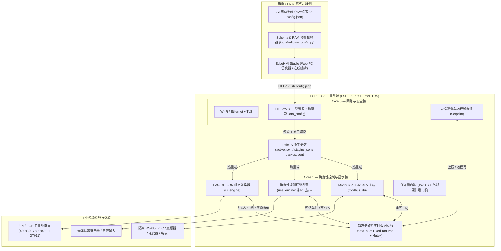

# EdgeHMI — 工业级 ESP32-S3 原生 C 底座 + JSON 组态渲染架构设计

## 1. 设计目标与核心原则

针对工业现场对 **确定性、长期无人值守、防抄板安全** 与 **快速定制交付、免编译热更新** 之间的矛盾，EdgeHMI 采用 **“底层纯 C 固化 + 上层 JSON 声明式组态”** 架构：

1. **零脚本虚拟机、零 GC 抖动**：彻底告别 Lua/MicroPython 在低内存 MCU 上的垃圾回收停顿与动态类型运行时 `nil` 崩溃。
2. **静态内存池设计**：测点总线（DataBus）、Modbus 点表、规则表均采用编译期定长静态池分配，运行期零 `malloc/free` 碎片化。
3. **跨核职责隔离（ESP32-S3 双核 FreeRTOS）**：
   - **Core 0（通信与运维核）**：Wi-Fi / W5500 以太网、MQTT Sparkplug B / JSON 上云、HTTP 配置热更新服务、OTA 校验。
   - **Core 1（控制与显示核）**：Modbus RTU/RS485 确定性轮询、本地安全联锁规则引擎、LVGL 9 局部增量渲染、硬件看门狗喂狗。
4. **一份 `config.json` 跨端运行**：同一份配置文件既可在 **PC 仿真工作台（Studio）** 实时预览调试，也可通过 HTTP/MQTT 直接热推至 **ESP32-S3 真机** 原子生效。
5. **故障安全与原子回滚**：新配置先写入 `staging` 区域，通过语法校验、内存预算检查和 SHA-256 校验后原子切换；若加载后看门狗复位，自动回滚至 `last_known_good` 配置。

---

## 2. 系统分层架构图



---

## 3. 核心模块职责与内存预算

| 模块 | 文件路径 | 职责 | 静态 RAM 预算 (ESP32-S3) |
| :--- | :--- | :--- | :--- |
| **实时数据总线** | `firmware/components/edgehmi_core/src/data_bus.c` | 最多 128 个静态 Tag，含值、类型、质量码（GOOD/BAD/STALE）、时间戳、脏标记与版本号 | ~8 KB (片内 SRAM) |
| **Modbus RTU 引擎** | `firmware/components/edgehmi_core/src/modbus_rtu.c` | FC01/03/05/06/16 组帧与解帧、CRC16 校验、缩放/偏移转换、超时重试与断线质量标脏 | ~4 KB (片内 SRAM) |
| **规则联锁引擎** | `firmware/components/edgehmi_core/src/rule_engine.c` | 最多 64 条确定性规则：比较算子 + 滞环（Hysteresis）+ 去抖延时（Debounce ms）+ 联动动作 | ~6 KB (片内 SRAM) |
| **JSON 配置加载器** | `firmware/components/edgehmi_core/src/config_loader.c` | 基于 cJSON 解析 `config.json`，严格边界检查并填充静态数据结构 | 解析峰值 ~24 KB（用后即释） |
| **LVGL 9 组态渲染器** | `firmware/main/ui_engine_lvgl.c` | 按 `pages` 与 `widgets` 描述创建 LVGL 对象，定时仅刷新 Dirty Tag 对应控件，点击直接写回 Bus | 显存走 8MB PSRAM（双缓冲） |
| **原子配置热更新** | `firmware/main/ota_config.c` | HTTP `POST /api/config` 接收新配置 $\to$ 校验 $\to$ 备份旧配置 $\to$ 原子替换并触发 UI/点表重载 | ~16 KB 缓冲 |

---

## 4. `config.json` 统一协议规范

一份完整的 `config.json` 由 4 个顶层段组成（完整 JSON Schema 见 [`schema/config.schema.json`](../schema/config.schema.json)）：

1. **`device`**：设备标识、屏幕分辨率（如 `800x480`）、主题（`dark`/`light`）、主循环周期（`poll_interval_ms`）、看门狗超时。
2. **`modbus`**：RS485 串口参数（波特率/校验/TX/RX/DE 引脚）与 **`points` 点表数组**（每个点绑定唯一 `tag`、从站地址 `slave`、功能码 `fc`、寄存器地址 `addr`、数据类型 `u16/i16/u32/f32/bool`、`scale`、`offset`、`rw` 读写权限）。
3. **`rules`**：本地安全联锁与告警规则数组（`when.tag`、`op`、`value`、`hysteresis`、`debounce_ms` $\to$ `then` 动作列表 `set_tag` / `alarm`）。
4. **`pages`**：多页面组态定义，每页包含带坐标/尺寸与样式的 **`widgets`**（支持 `card`、`label`、`value`、`gauge`、`bar`、`button`、`switch`、`badge`、`chart`），通过 `bind` 绑定 `data_bus` 中的 `tag`。

---

## 5. 目录结构

```text
esp32-ind-hmi/
├── docs/
│   └── ARCHITECTURE.md              # 架构设计文档
├── schema/
│   └── config.schema.json           # config.json 严格 Schema 规范
├── configs/
│   ├── pump_station.json            # 工业案例 1：智慧水泵站 HMI + 液位联锁
│   └── solar_inverter.json          # 工业案例 2：光储逆变器监控 + 防逆流保护
├── firmware/                        # ESP-IDF 5.x + LVGL 9 真机固件工程
│   ├── CMakeLists.txt
│   ├── partitions.csv               # 双 OTA + LittleFS 双配置分区表
│   ├── sdkconfig.defaults           # ESP32-S3 + 8MB PSRAM 默认配置
│   ├── sdkconfig.defaults.prod      # 量产安全强化 (Secure Boot + Flash 加密)
│   ├── components/
│   │   └── edgehmi_core/            # 纯 ANSI C11 核心层 (零 ESP 依赖，可宿主机编译单测)
│   │       ├── CMakeLists.txt
│   │       ├── include/
│   │       │   ├── edgehmi_types.h
│   │       │   ├── data_bus.h
│   │       │   ├── modbus_rtu.h
│   │       │   ├── rule_engine.h
│   │       │   └── config_loader.h
│   │       ├── third_party/cjson/   # 轻量 MIT cJSON 源码
│   │       └── src/
│   │           ├── data_bus.c
│   │           ├── modbus_rtu.c
│   │           ├── rule_engine.c
│   │           └── config_loader.c
│   └── main/
│       ├── CMakeLists.txt
│       ├── main.c                   # 双核 FreeRTOS 启动、RS485、LVGL 调度、TWDT
│       ├── ui_engine_lvgl.h
│       ├── ui_engine_lvgl.c         # LVGL 9 声明式 JSON 渲染引擎
│       ├── ota_config.h
│       └── ota_config.c             # HTTP 配置热更新 + 原子校验回滚
├── tests/
│   └── test_core.c                  # 纯 C11 宿主机单元测试 (覆盖总线/Modbus/规则/解析)
├── tools/
│   ├── validate_config.py           # JSON Schema 校验 + ESP32 内存预算 + 点表冲突检测
│   └── push_config.py               # 一键校验并热推 config.json 到 ESP32 设备
└── studio/                          # PC 交互式组态仿真工作台 (无需硬件实时跑)
    ├── server.py                    # 实时物理/Modbus 仿真后端 + 热更新 API
    └── web/
        └── index.html               # 像素级 HMI 仿真屏 + JSON 在线编辑 + 故障注入
```
